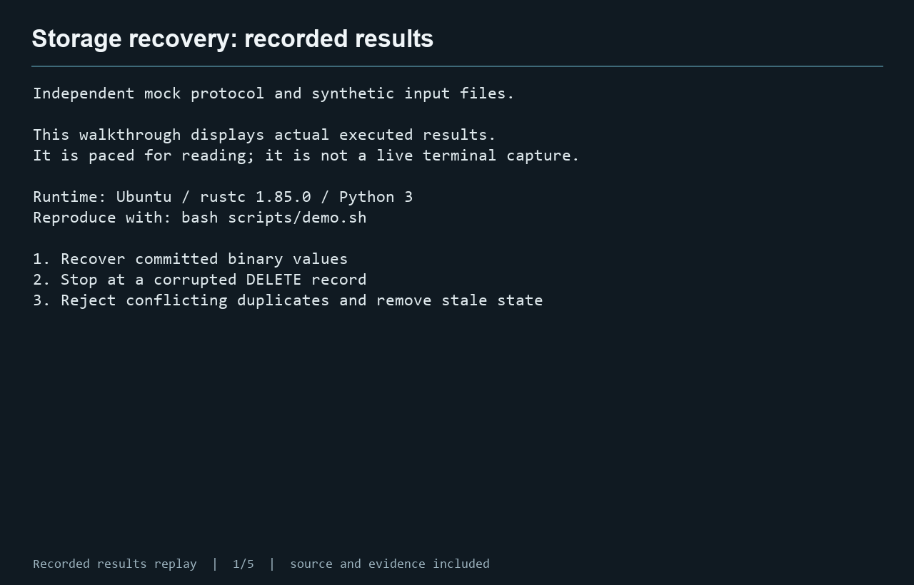

# Crash-safe storage recovery

[](https://github.com/bcadamslange-rgb/storage-recovery-sample/actions/workflows/verify.yml)

A small storage service has lost its in-memory index during interrupted compaction. Its append-only segment files remain, with potentially torn records. This exercise reconstructs the durable state and explains the recovery decisions in machine-readable JSON.

The wire format is invented. All sample records are synthetic. See [scope](SCOPE.md).

## What this sample demonstrates

Rust file parsing, CRC-32C validation, transaction grouping across files, compaction graph validation, logical ordering, duplicate conflict handling and deterministic serialization. Python tests independently construct binary inputs and expected results from the specification.

## Run the demonstration

Requires Rust/Cargo 1.85 or newer, Python 3.10 or newer and a native linker. The Rust project has no third-party crate dependencies.

From this folder on Linux:

```bash
bash scripts/demo.sh
```

On Windows with an installed Rust toolchain and Python:

```powershell
powershell -File scripts/demo.ps1
```

Linux was executed during preparation. The PowerShell entrypoint is supplied for convenience; native Windows behavior was not tested.

The command demonstrates committed binary values, a damaged DELETE record and a conflicting duplicate. Runtime output goes to `results/demo/`, separate from the input files.

## Run the checks

```bash
cargo build --release --locked --offline
python3 tests/verify.py --binary target/release/kvrecover
python3 scripts/check_negative_controls.py
```

The public suite has 24 named behavior cases and 40 reproducible seeded logical-order cases. It compares exact state/report bytes, checks exit status and stale-state handling, fingerprints inputs and runs a three-run repeatability check. The incorrect controls demonstrate that these checks detect physical-order replay and skipped CRC validation.

## Container recipe

```bash
docker build -t storage-recovery .
mkdir -p results/container
docker run --rm --user "$(id -u):$(id -g)" -v "$PWD/examples/visible-inputs/basic_commit_and_delete:/input:ro" -v "$PWD/results/container:/output" storage-recovery --segments /input --out-state /output/state.json --out-report /output/report.json
```

The image defaults to an unprivileged user. The Linux example runs as the current host user so the output bind mount is writable without broadening directory permissions. Run it from a normal non-root account. The container build and sample recovery passed in [GitHub Actions](https://github.com/bcadamslange-rgb/storage-recovery-sample/actions/runs/40826669614). See the validation record for the exact scope of the checks.

## Continuous verification

The included GitHub Actions workflow builds the Rust executable, runs the public behavioral suite and incorrect controls, and builds and exercises the container. Its status reflects the actual hosted workflow result, independently of the recorded local evidence.

## Inspect the work

- [Specification](SPEC.md)
- [Task brief](docs/TASK_BRIEF.md)
- [Implementation decisions and limits](docs/IMPLEMENTATION.md)
- [Measured validation](docs/VALIDATION.md)
- [Public verification results](evidence/public-verification.json)
- [Incorrect-control results](evidence/negative-control-results.json)
- [Review prompt](docs/REVIEW_PROMPT.txt)

Expected outputs in the tests were authored independently of the Rust executable. Public fixture constructors and results are included. The internal corpus inputs and expected files are intentionally excluded from the public sample; its aggregate result cannot be independently reproduced from this package alone.

## Demonstration preview


